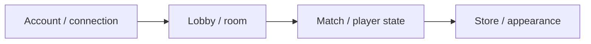

# DumbGuys — Game Server

[English](README.md) · [Korean](README.ko.md) · [Japanese](README.ja.md)

**C++ · C# · Unity** · 開発記録

[開発事例を見る](https://ysl-ryudo.github.io/ja/work/dumbguys/) · [Portfolio](https://ysl-ryudo.github.io/ja/)

DumbGuys Unityクライアントと接続するWindows C++サーバーです。

## 取り組んだ課題

アカウント、ルーム、プレイヤー外見をロビーと試合の流れにつなぐ実装です。クライアントとサーバーの互換性がある版を選ぶことも重要です。

## 担当した実装と設計

アカウント・接続処理、ルーム・プレイヤー状態、ショップ・外見データ、クライアントのロビー・試合連携を担当しました。

### 実装概要 · 概念フロー

### 開発デモ動画

- [DumbGuys full play](https://www.youtube.com/watch?v=Z4tffAvRjJs)

撮影時点のプロジェクトデモです。ゲーム内での担当作業は以下の担当範囲で示します。

## 担当した内容

- ゲームクライアントのアカウント・接続処理を実装しました。
- ルーム・試合・プレイヤー状態、ショップ・外見関連データを担当しました。
- クライアントのロビー・試合フローにサーバーを接続しました。

## 貢献の根拠

- [Source baseline / 코드 기준 / コード基準](https://github.com/YSL-RyuDo/DumbGuysServer/tree/2ba094126a0bb09ace4167dc3c2e956c4a39dec2)
- [Development history / 개발 이력 / 開発履歴](https://github.com/YSL-RyuDo/DumbGuysServer/commits/main/?author=YSL-RyuDo)

コミットは記載した変更の根拠であり、貢献率の点数ではありません。外部素材・チームメンバーの貢献は区別します。

## 実行・コードの確認

Windows C++ワークロードを備えたVisual Studioで[DumbGuysServer.sln](DumbGuysServer.sln)を開いてください。構成・データパス・依存関係・接続設定を確認し、対応するクライアントを起動します。既存アカウントデータは維持してください。

[DumbGuys](https://github.com/YSL-RyuDo/DumbGuys)

## 開発・検証範囲

過去の開発用サーバーです。現行性能や耐障害性の検証完了は主張しません。互換性のあるデモ版を選ぶ際はクライアントのrestore-1121も確認してください。

## 実装の確認方法

デモ前にサーバーの基準版とクライアントの後続restore-1121ブランチを比較してください。記録は実装範囲を示すもので、新しい性能測定ではありません。
