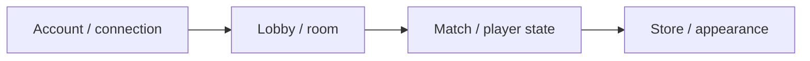

# DumbGuys — Game Server

[English](README.md) · [Korean](README.ko.md) · [Japanese](README.ja.md)

**C++ · C# · Unity** · 개발 기록

[개발 사례 보기](https://ysl-ryudo.github.io/ko/work/dumbguys/) · [Portfolio](https://ysl-ryudo.github.io/ko/)

DumbGuys Unity 클라이언트와 연결되는 Windows C++ 서버입니다.

## 해결하려던 문제

계정·방·플레이어 외형 정보를 로비와 경기 흐름으로 연결하는 작업입니다. 클라이언트와 서버를 서로 맞는 버전에서 살펴보는 것도 중요합니다.

## 내 구현과 설계

계정·연결 처리, 방·플레이어 상태, 상점·외형 데이터와 클라이언트 로비·경기 연동을 작업했습니다.

### 구현 개요 · 개념 흐름도

### 개발 시연 영상

- [DumbGuys full play](https://www.youtube.com/watch?v=Z4tffAvRjJs)

촬영 당시의 프로젝트 시연입니다. 게임 안에서 제가 맡은 작업은 아래 기여 항목으로 구분합니다.

## 내 기여

- 게임 클라이언트의 계정·연결 처리를 구현했습니다.
- 방·매치·플레이어 상태와 상점·외형 관련 데이터를 작업했습니다.
- 클라이언트의 로비·경기 흐름과 서버를 연동했습니다.

## 기여 근거

- [Source baseline / 코드 기준 / コード基準](https://github.com/YSL-RyuDo/DumbGuysServer/tree/2ba094126a0bb09ace4167dc3c2e956c4a39dec2)
- [Development history / 개발 이력 / 開発履歴](https://github.com/YSL-RyuDo/DumbGuysServer/commits/main/?author=YSL-RyuDo)

커밋은 설명한 변경의 근거이며 기여율 점수가 아닙니다. 외부 에셋과 팀원 작업의 크레딧은 구분합니다.

## 실행·코드 확인

Windows C++ 워크로드가 설치된 Visual Studio에서 [DumbGuysServer.sln](DumbGuysServer.sln)을 여세요. 구성·데이터 경로·의존성·접속 설정을 확인한 뒤 대응하는 클라이언트를 실행하세요. 기존 계정 데이터를 보존하세요.

[DumbGuys](https://github.com/YSL-RyuDo/DumbGuys)

## 개발·검증 범위

과거 개발 서버입니다. 현재 성능이나 장애 내성에 대한 검증 완료를 주장하지 않습니다. 시연 버전을 정할 때 클라이언트의 후속 restore-1121 브랜치를 함께 확인해야 합니다.

## 구현을 확인하는 방법

시연 전 서버 기준 버전과 클라이언트의 후속 restore-1121 브랜치를 비교해야 합니다. 개발 기록은 구현 범위를 설명하며 새로 측정한 성능 결과는 아닙니다.
